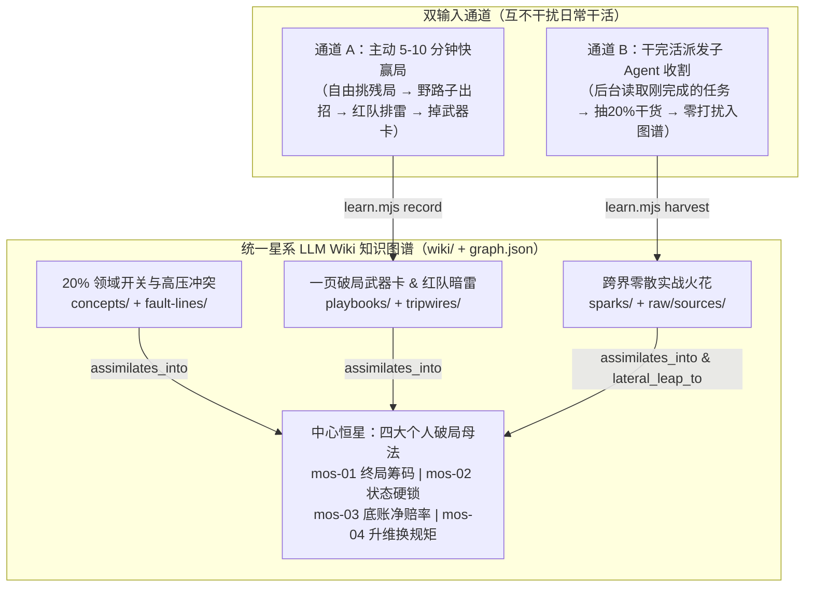

<!-- 文件职责：阐述专为 Jack 个体风格设计的母法星系 LLM Wiki 知识图谱、5分钟快赢对练与事后子 Agent 自动收割完整方案。 -->
# 专属认知架构与星系图谱完整方案

适用范围：`/Users/jack/Documents/codes/lvgou/ai-learning` 与全局 `~/.agents/skills/agent-learn` 的总体设计说明。

---

## 一、你的真实画像如何决定整套系统架构？

基于你的核心特质反复推敲，市面上常规的“AI 私教 / 每日打卡 / 章节闯关 / 百科笔记”全部会被淘汰，原因与解法如下表：

| 你的真实特质 | 常规方案为什么必败 | 本系统的针对性工程设计 |
| --- | --- | --- |
| **日常用 Agent 是为了高效干活，不是时刻上课** | 普通提问误触发苏格拉底反问，极度耽误效率 | **手动挡显式门控**：日常提问 0% 触发；仅显式点名 `agent-learn` 时启动，随时说“直接给结论”秒退 |
| **追求高效，讨厌深入钻牛角尖学太深的东西** | 越讲越碎，陷入法条编号、学术流派和八股细节 | **20/80 深度熔断硬红线**：每张卡片强制切分「主帅必抓 20% 开关」与「甩给 AI 干的 80% 苦力」，`lint` 脚本直接检查 80% 熔断栏 |
| **急切见到成功，需要立竿见影的正反馈** | 先铺垫十节基础理论课，迟迟摸不到实战收益 | **自由空降 + 10 分钟掉卡**：废除前置串行锁，上来直接挑真金白银残局打；每赢一局当场铸造一张**《一页破局武器卡》** |
| **倾向用自己的一套方法论解决所有事** | 每学一个新领域都要重背一套别人的黑话框架 | **星系母法同化（`wiki/master-os/`）**：以你自己的四步通用破局母法为唯一引力中心，法务/金融/技术新知全部编译成母法插件 |
| **思维发散不按常理，对比细节控容易漏看暗雷** | 野路子被死板判错；或实战中奇招百出却栽在一根细节暗线上 | **发散奇招优先 + AI 红队防雷（`wiki/tripwires/`）**：鼓励商业/技术跨界破局，AI 专职当细心参谋替你盯死那 1 颗致命暗雷 |
| **干完活想派子 Agent 把零散经验顺手接进图谱** | 传统学习与日常干活割裂，零散实战点散落丢失 | **后台子 Agent 收割通道（`learn.mjs harvest`）**：干完活一句话派发子 Agent，自动提炼 20% 破局点挂入母法图谱，不打断主线 |

---

## 二、融合进系统的六大方法论与变体

1. **原视频母体改造 ——「三问极速建图变体」**：保留 `@ihtesham2005` 的“抓专家共识模型 + 抓最凶冲突点 + 抗背诵实测”，砍掉硬啃 6 本教材与固定数字配额，直奔实战残局。
2. **Tim Ferriss `DiSSS` × 最小有效剂量（MED 20/80 熔断）**：明确界定哪些细节属于“多学一分钟都亏”的机器苦力区。
3. **芒格格栅反向变体 ——「个人母法吞并法」**：不是攒十门学科，而是用 4 颗个人母法恒星（终局筹码、状态硬锁、底账净赔率、升维换规矩）吞并一切外部规则。
4. **兵棋推演 ——「野路子破局 + 红队参谋排雷法」**：把你的发散创造力放大到极致，把细心抠漏洞的脏活累活锁死给 AI 红队。
5. **Gary Klein「事前验尸（Pre-Mortem）」版三句话费曼**：不背定义，只用三句大白话点破“这单生意半年后死在哪、对方怎么搞你、怎么改结构反杀”。
6. **Karpathy `LLM Wiki v2` × 星系有向语义图谱**：兼顾本机 LLM Wiki 桌面端可视化与 `wiki/graph.json` 带权有向边遍历，让零散火花自动产生跨界化学反应。

---

## 三、双通道协同与星系知识图谱拓扑

---

## 四、如何在日常中最爽快地用起来？

### 场景 1：平时正常干活（95% 时间）
什么都不用管，直接问问题、写代码、跑 `ai-distill`，`agent-learn` 绝不跳出来插嘴。

### 场景 2：刚干完一件漂亮活（改完架构 / 解掉棘手题包 / 谈妥合作）
顺手丢一句：
> **「`用 agent-learn 派个子 agent 把刚才干完的这件事提炼进我的学习图谱`」**  
主 Agent 会立即在后台拉起 `Learning Graph Harvester` 子 Agent，自动落盘原始切片、生成 `sp-*` 火花页、挂到你的母法恒星上并刷新 `wiki/graph.json`，全程不耽误你干下一件事。

### 场景 3：有 5–10 分钟想刷法务/新领域战果
丢一句：
> **「`用 agent-learn 来一局 jack-legal 快赢`」**（或直接打开 [2026-11-26-fast-win-arena.md](../projects/jack-legal/sessions/2026-11-26-fast-win-arena.md) 挑 A/B/C 任一残局拍板）  
三五句话过招排雷，当场拿走一张新武器卡。

### 场景 4：打开可视化星系知识图谱浏览
打开你电脑上正在运行的 **LLM Wiki 桌面端**（或 Obsidian），直接添加目录 `/Users/jack/Documents/codes/lvgou/ai-learning`，即可交互式查看围绕 4 颗母法恒星生长的整张跨界知识网络。
